<div align="center">

# Devices Control

**See every device in your Windows PC, understand what it does, and switch it on or off safely from a local web UI.**


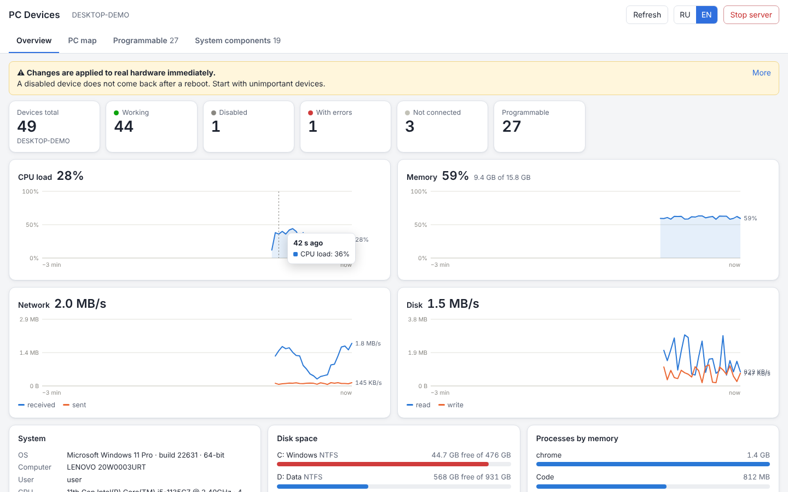

</div>

> [!WARNING]
> This tool changes **real hardware state**. A disabled device does **not** come back after a reboot.
> Disable the USB controller your keyboard and mouse hang on, and the only way back is Device Manager,
> which you can no longer reach with the mouse. Try harmless devices first (a COM port, the camera).
> Working remotely? Read [Using it remotely](#using-it-remotely) first.

---

## Features

| | |
|---|---|
| **Interactive PC map** | An illustrated PC: hover a part to see its devices, click to drill into its device tree. Hovering a node lights up everything that would go down with it. |
| **Overview dashboard** | Device counters, live CPU / memory / network / disk charts, disk space, system info, devices with errors, disabled devices with one-click **Enable**, action history. |
| **Explains every device** | 180+ rules recognise devices by hardware ID (works on any Windows language), name the function, the vendor (PCI / USB / EDID), and show how to drive it from code. Inferred conclusions are labelled *assumption*. |
| **Safety checks, not guesses** | Risk is not judged by class alone: before disabling, the tool walks the device tree and warns if a keyboard, mouse, disk, network adapter or display depends on it, if the adapter carries your internet, or if you are in an RDP session. |
| **Audio done right** | Speakers / microphones are switched through the Windows audio policy (the same call the Sound control panel makes), and the UI tells you where Windows routed the sound. |
| **Search & filters** | By name, function, class, vendor or ID; filter by function group, state and risk level. |
| **English / Russian** | Switch the interface language at any time. Light and dark theme follow the system. |
| **Auto-revert** (v3) | Arm a disable with a timer: unless you confirm in time, Windows enables the device again by itself. The job lives in Task Scheduler, so it works even if the connection, the browser or this tool is gone. |
| **Remote-session aware** (v3) | SSH, RDP, WinRM and VNC sessions are detected, and so are remote-access tools. The adapter carrying your session, and everything it hangs off (PCIe port, USB hub), can be disabled only with auto-revert. |
| **Phone friendly** (v3) | On a touch screen a tap shows what hover would show, in a bottom sheet, including the red "goes down with it" subtree. |
| **Audit log** | Every enable / disable and every auto-revert is written to a log, so you can always see what changed and undo it. |

## Screenshots

<table>
  <tr>
    <td width="50%">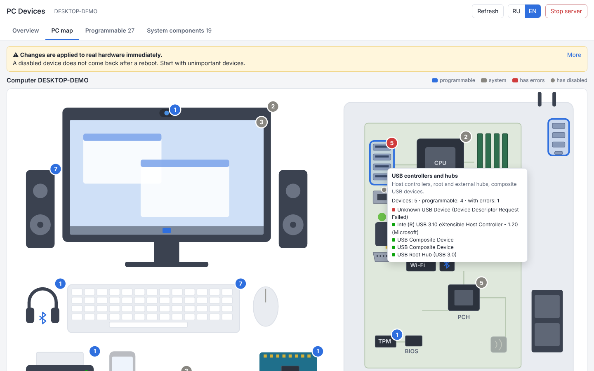<br><sub><b>PC map.</b> Blue: programmable parts, grey: system parts. Badges count devices, red means errors.</sub></td>
    <td width="50%">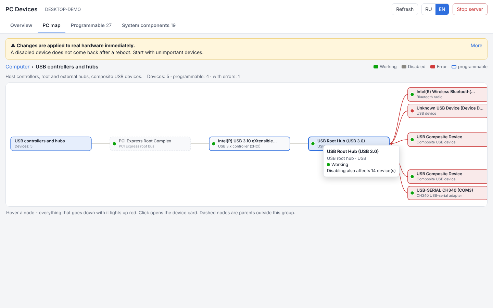<br><sub><b>Drill-down tree.</b> Hovering the USB root hub shows the 14 devices that would be cut off.</sub></td>
  </tr>
  <tr>
    <td>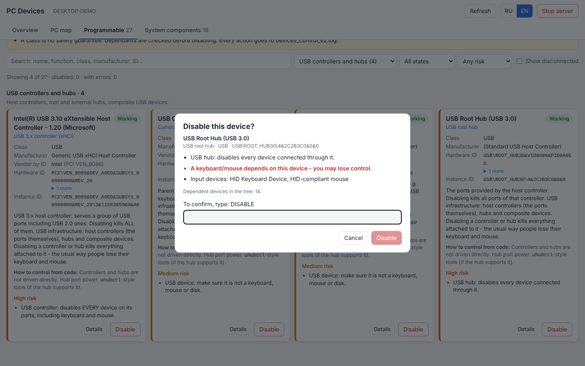<br><sub><b>Confirmation.</b> A keyboard and mouse depend on this hub, so the tool asks you to type <code>DISABLE</code>.</sub></td>
    <td>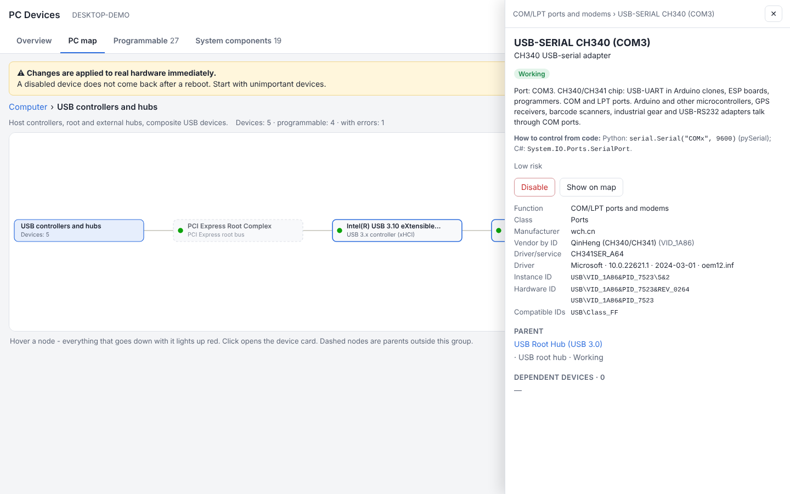<br><sub><b>Device card.</b> Function, explanation, how to use it from code, driver, IDs, parent and children.</sub></td>
  </tr>
  <tr>
    <td>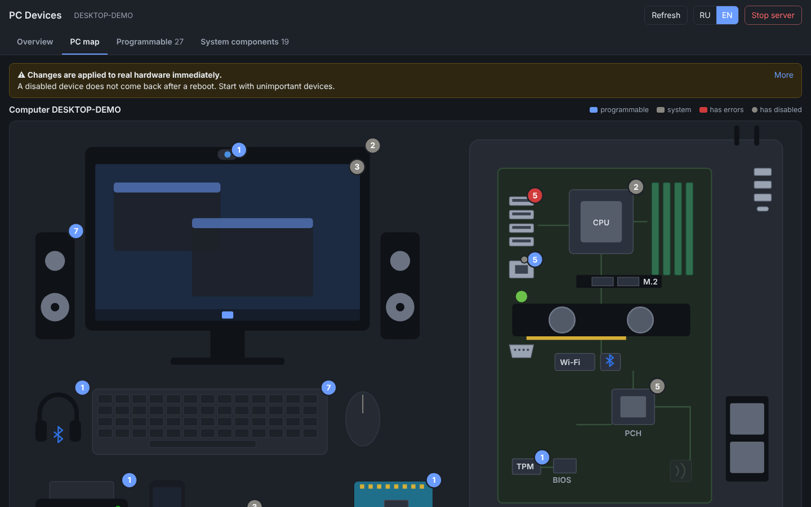<br><sub><b>Dark theme.</b> Follows the Windows setting.</sub></td>
    <td>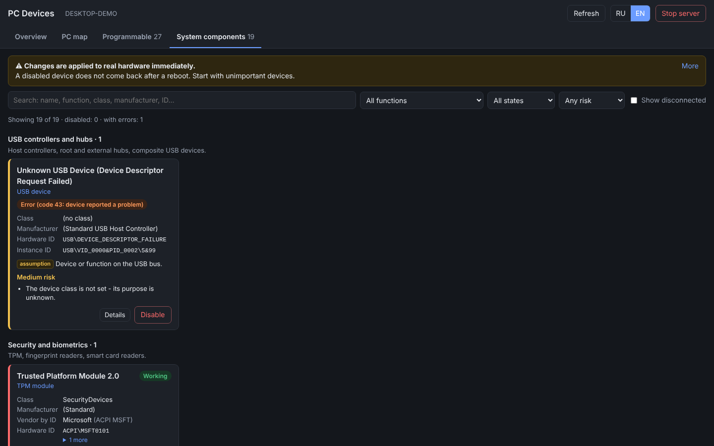<br><sub><b>System components</b>, grouped by what they do.</sub></td>
  </tr>
</table>

### Remote work (v3)

<table>
  <tr>
    <td width="50%">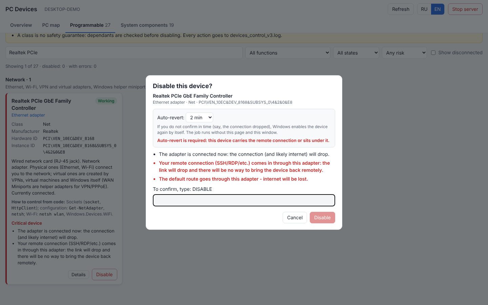<br><sub><b>Mandatory auto-revert.</b> The remote session comes in through this adapter, so "off" is not offered and the timer cannot be skipped.</sub></td>
    <td width="50%">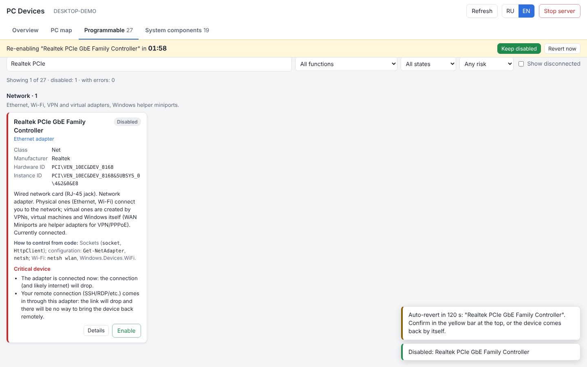<br><sub><b>Countdown.</b> The yellow bar stays on every tab. <i>Keep disabled</i> cancels the revert, <i>Revert now</i> does it immediately.</sub></td>
  </tr>
</table>

<table>
  <tr>
    <td width="50%" align="center">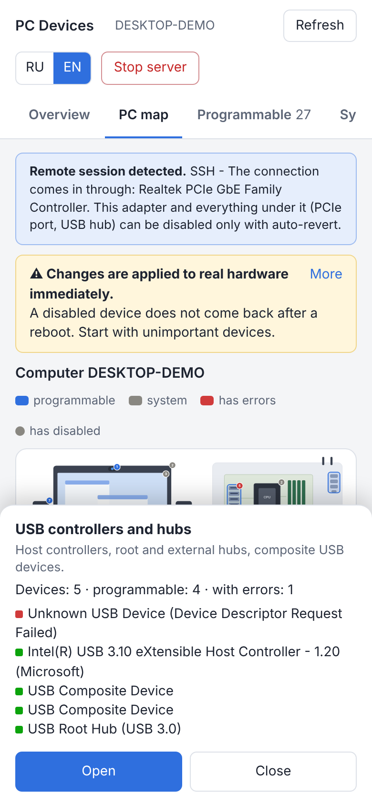<br><sub><b>Phone: tap a part of the PC.</b> The sheet lists its devices; <i>Open</i> drills in.</sub></td>
    <td width="50%" align="center">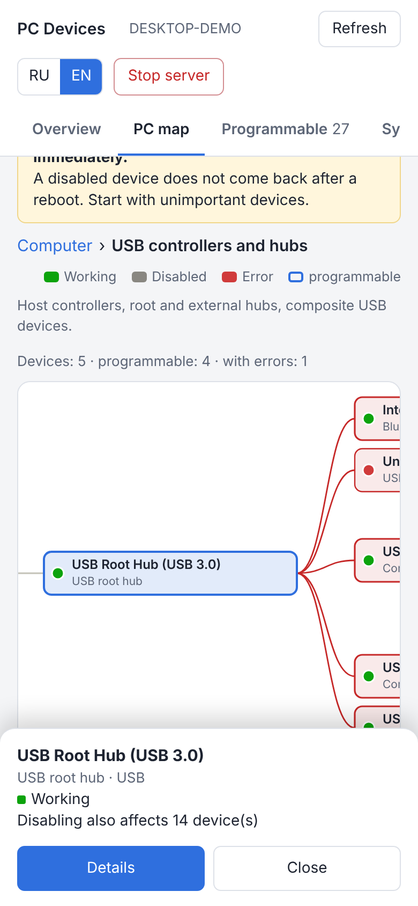<br><sub><b>Phone: tap a node.</b> Red shows everything that goes down with it.</sub></td>
  </tr>
</table>

## Quick start

1. Download the repository (**Code → Download ZIP**) and unpack it.
2. Open the `devices_control_v3` folder and double-click **`devices_control_v3.bat`**.
3. Accept the UAC prompt: Windows requires administrator rights to enable or disable devices.
   If you decline, the tool still runs in read-only mode.
4. Your default browser opens the UI. To stop, click **Stop server** or close the PowerShell window.

Nothing to install: it uses only Windows PowerShell and built-in Windows APIs.

```powershell
# Optional: fixed port, no browser auto-start
.\devices_control_v3.ps1 -Port 8080 -NoBrowser

# Keep the token and port between runs, so a bookmarked link keeps working
.\devices_control_v3.ps1 -Port 8080 -RememberToken
```

## Using it remotely

The server only ever listens on `127.0.0.1`, so a phone or another PC reaches it through an **SSH tunnel**, not by opening a port. Do **not** forward the port on your router: the panel has administrator rights over your hardware.

1. **On the PC, once** (administrator PowerShell): install the OpenSSH server.
   ```powershell
   Add-WindowsCapability -Online -Name OpenSSH.Server~~~~0.0.1.0
   Start-Service sshd; Set-Service sshd -StartupType Automatic
   ```
2. **Outside your home network**, install [Tailscale](https://tailscale.com) on the PC and on the phone / laptop, and use the PC's `100.x.x.x` address below.
3. **Start the server** on the PC with a fixed port and a remembered token, either in a console on the PC or in the SSH session:
   ```powershell
   .\devices_control_v3.ps1 -Port 8080 -RememberToken
   ```
   Log in over SSH with an **administrator** account, otherwise Windows would need a UAC click on the PC's screen.
4. **Open the tunnel** from the phone (Termius and similar apps support port forwarding) or laptop:
   ```
   ssh -L 8080:127.0.0.1:8080 admin@<pc-address>
   ```
5. Open `http://127.0.0.1:8080/?t=<token>` in the phone's browser. Read the token from the server console, or over SSH from `%ProgramData%\devices_control\token.txt`. The local and remote port must match, otherwise the server rejects the request.

Rules for remote work:

- The adapter that carries your session, and everything above it, is locked unless you arm auto-revert. Leave it armed.
- Keep the PC from sleeping, or there is nothing to connect to.
- Delete `token.txt` to rotate the token. Anyone who sees the link while the server runs can control the device.

## How it works

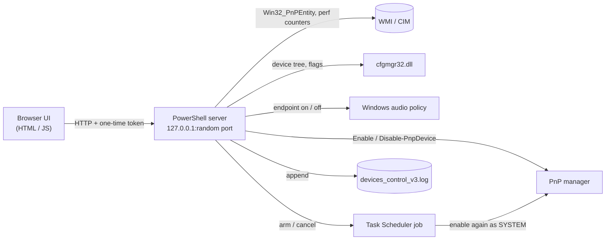

- The server listens on **127.0.0.1 only**, on a random port, and every API call needs a **one-time token** generated at start-up.
- Requests with a foreign `Host` header are rejected (DNS-rebinding protection), the API requires a custom header (blocks cross-site requests), and the page ships with a strict Content-Security-Policy.
- The browser is opened through `explorer.exe`, so it runs as your normal user, not as administrator.
- The auto-revert script is stored in `%ProgramData%\devices_control`, a folder writable only by administrators and SYSTEM. It is executed as SYSTEM, so a normal user must never be able to edit it. If the folder has an unexpected owner, auto-revert is refused instead of used.

## Safety model

| Level | Examples | What the UI asks |
|---|---|---|
| Low | COM port, camera, virtual printer | Simple confirmation |
| Medium / High | USB devices, network adapters, display, HID | Tick *"I understand the consequences"* |
| Critical | CPU, chipset, disks, TPM, or anything a keyboard / mouse / disk depends on | Type `DISABLE`; the server refuses without it |

Devices that Windows itself marks as non-disableable have the button blocked.

If a remote session is detected, the server (not just the UI) refuses to disable the adapter carrying it, or any device above it in the tree, without an auto-revert of 15 to 900 seconds. If auto-revert cannot be armed (for example the Task Scheduler service is off), the device is **not** disabled.

## Getting a device back

- the yellow bar: **Revert now**, or
- **Overview → Disabled devices → Enable**, or
- Device Manager (`devmgmt.msc`) → the device → **Enable device**, or
- an admin PowerShell, with the ID from `devices_control_v3.log`:

```powershell
Enable-PnpDevice -InstanceId '<ID from the log>' -Confirm:$false
```

## Repository layout

```
devices_control_v3/          ← current version
├── devices_control_v3.bat   launcher (double-click)
├── devices_control_v3.ps1   local server
└── web/                     UI: index.html, app.css, i18n.js, knowledge.js,
                             app.js, rollback.js, map.js, dashboard.js, main.js
devices_control_v2/          previous version: PC map, dashboard, explanations
devices_control_v1/          first version: single-page list with enable/disable
docs/screenshots/            images used in this README
```

## Versions

| Version | Highlights |
|---|---|
| **v3** | Auto-revert through Task Scheduler, detection of SSH / RDP / WinRM / VNC sessions and remote-access tools, server-side lock on the adapter carrying your session, touch mode with a bottom sheet, `-RememberToken` for stable links. |
| **v2** | PC map with drill-down device tree, overview dashboard with live charts, detailed per-device explanations, functional grouping, correct audio endpoint switching, driver info, faster device tree via cfgmgr32. |
| **v1** | Device list split into programmable / other, search and filters, enable / disable with confirmation and dependency check, EN / RU, audit log. |

## Testing note

The UI and the server logic were tested end to end against the real PowerShell server (running on
Linux) with Windows calls replaced by mocks: 49 simulated devices, a simulated SSH session, and a
stand-in for Task Scheduler that really runs the generated `rollback.ps1` at the due time. That covers
the logic: arming, firing, confirming, reverting, refusing when the scheduler is broken, restart with a
pending job.

Not yet confirmed on real Windows hardware: registering the scheduled task, the folder ACL, the
audio-policy call when it runs as SYSTEM, `cfgmgr32`, and mapping an SSH connection to its adapter.
**Try auto-revert on a harmless device (the camera, a COM port) before you rely on it.** Screenshots
come from the simulated machine, so device names and numbers are sample data.

## Disclaimer

Use at your own risk. Disabling the wrong device can cut your network, input devices or storage.
The authors are not responsible for any damage or data loss.
