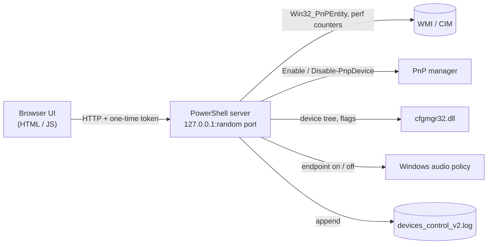

<div align="center">

# Devices Control

**See every device in your Windows PC, understand what it does, and switch it on or off safely from a local web UI.**


</div>

> [!WARNING]
> This tool changes **real hardware state**. A disabled device does **not** come back after a reboot.
> Disable the USB controller your keyboard and mouse hang on, and the only way back is Device Manager,
> which you can no longer reach with the mouse. Try harmless devices first (a COM port, the camera).

---

## Features

| | |
|---|---|
| **Interactive PC map** | An illustrated PC: hover a part to see its devices, click to drill into its device tree. Hovering a node lights up everything that would go down with it. |
| **Overview dashboard** | Device counters, live CPU / memory / network / disk charts, disk space, system info, devices with errors, disabled devices with one-click **Enable**, action history. |
| **Explains every device** | 180+ rules recognise devices by hardware ID (works on any Windows language), name the function, the vendor (PCI / USB / EDID), and show how to drive it from code. Inferred conclusions are labelled *assumption*. |
| **Safety checks, not guesses** | Risk is not judged by class alone: before disabling, the tool walks the device tree and warns if a keyboard, mouse, disk, network adapter or display depends on it, if the adapter carries your internet, or if you are in an RDP session. |
| **Audio done right** | Speakers / microphones are switched through the Windows audio policy (the same call the Sound control panel makes), and the UI tells you where Windows routed the sound. |
| **Search & filters** | By name, function, class, vendor or ID; filter by function group, state and risk level. |
| **English / Russian** | Switch the interface language at any time. Light and dark theme follow the system. |
| **Audit log** | Every enable / disable is written to a log file with the device ID, so you can always undo it. |

## Screenshots

<table>
  <tr>
    <td width="50%"><br><sub><b>PC map.</b> Blue: programmable parts, grey: system parts. Badges count devices, red means errors.</sub></td>
    <td width="50%"><br><sub><b>Drill-down tree.</b> Hovering the USB root hub shows the 14 devices that would be cut off.</sub></td>
  </tr>
  <tr>
    <td><br><sub><b>Confirmation.</b> A keyboard and mouse depend on this hub, so the tool asks you to type <code>DISABLE</code>.</sub></td>
    <td><br><sub><b>Device card.</b> Function, explanation, how to use it from code, driver, IDs, parent and children.</sub></td>
  </tr>
  <tr>
    <td><br><sub><b>Dark theme.</b> Follows the Windows setting.</sub></td>
    <td><br><sub><b>System components</b>, grouped by what they do.</sub></td>
  </tr>
</table>

## Quick start

1. Download the repository (**Code → Download ZIP**) and unpack it.
2. Open the `devices_control_v2` folder and double-click **`devices_control_v2.bat`**.
3. Accept the UAC prompt: Windows requires administrator rights to enable or disable devices.
   If you decline, the tool still runs in read-only mode.
4. Your default browser opens the UI. To stop, click **Stop server** or close the PowerShell window.

Nothing to install: it uses only Windows PowerShell and built-in Windows APIs.

```powershell
# Optional: fixed port, no browser auto-start
.\devices_control_v2.ps1 -Port 8080 -NoBrowser
```

## How it works



- The server listens on **127.0.0.1 only**, on a random port, and every API call needs a **one-time token** generated at start-up.
- Requests with a foreign `Host` header are rejected (DNS-rebinding protection), the API requires a custom header (blocks cross-site requests), and the page ships with a strict Content-Security-Policy.
- The browser is opened through `explorer.exe`, so it runs as your normal user, not as administrator.

## Safety model

| Level | Examples | What the UI asks |
|---|---|---|
| Low | COM port, camera, virtual printer | Simple confirmation |
| Medium / High | USB devices, network adapters, display, HID | Tick *"I understand the consequences"* |
| Critical | CPU, chipset, disks, TPM, or anything a keyboard / mouse / disk depends on | Type `DISABLE`; the server refuses without it |

Devices that Windows itself marks as non-disableable have the button blocked.

## Getting a device back

- **Overview → Disabled devices → Enable**, or
- Device Manager (`devmgmt.msc`) → the device → **Enable device**, or
- an admin PowerShell, with the ID from `devices_control_v2.log`:

```powershell
Enable-PnpDevice -InstanceId '<ID from the log>' -Confirm:$false
```

## Repository layout

```
devices_control_v2/          ← current version
├── devices_control_v2.bat   launcher (double-click)
├── devices_control_v2.ps1   local server
└── web/                     UI: index.html, app.css, i18n.js, knowledge.js,
                             app.js, map.js, dashboard.js, main.js
devices_control_v1/          first version: single-page list with enable/disable
docs/screenshots/            images used in this README
```

## Versions

| Version | Highlights |
|---|---|
| **v2** | PC map with drill-down device tree, overview dashboard with live charts, detailed per-device explanations, functional grouping, correct audio endpoint switching, driver info, faster device tree via cfgmgr32. |
| **v1** | Device list split into programmable / other, search and filters, enable / disable with confirmation and dependency check, EN / RU, audit log. |

## Testing note

The UI and the server logic were tested end to end against the real PowerShell server with Windows
calls replaced by mocks (49 simulated devices). The native calls (`cfgmgr32`, Windows audio policy)
compile, but their behaviour still needs confirming on real hardware. Screenshots come from that
simulated machine, so the device names and numbers are sample data.

## Disclaimer

Use at your own risk. Disabling the wrong device can cut your network, input devices or storage.
The authors are not responsible for any damage or data loss.
